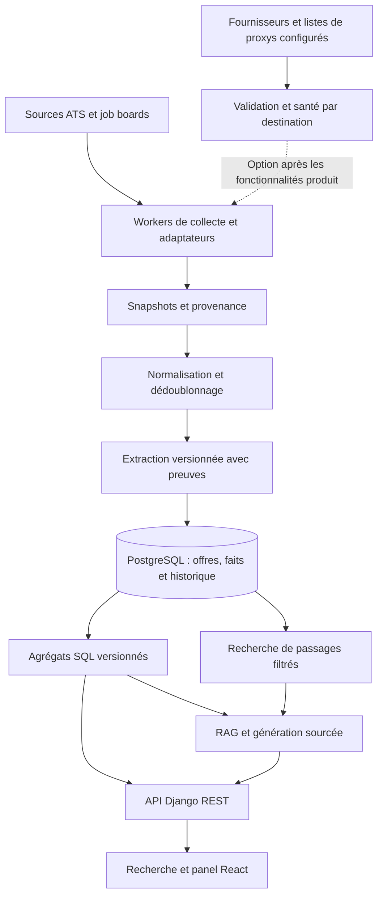

# Architecture — Catalogue informatique et intelligence du marché

Version 2 · 28 octobre 2026 · Cible de développement issue du [PRD](PRD.md).
Ordre de réalisation : [ROADMAP.md](ROADMAP.md). Les éléments marqués « cible »
ne sont pas annoncés comme déjà implémentés.

## 1. Existant constaté

| Élément | Preuve dans le dépôt |
| --- | --- |
| React, TypeScript, Vite, React Router, Playwright | `frontend/package.json` |
| Django, DRF, Python, uv ; JobSpy épinglé sur un commit | `metier/pyproject.toml`, `metier/uv.lock` |
| PostgreSQL 16 et processus workers séparés | `compose.yaml` |
| Offres, sources, exécutions, données brutes et rémunérations | `metier/app/jobboard/models/catalogue.py` |
| Taxonomie existante | `metier/app/jobboard/models/taxonomy.py` |
| JobSpy isolé en sous-processus avec timeout ; filtre stage explicite | `metier/app/jobboard/integrations/jobspy_runner.py`, `jobspy_catalogue.py` |
| Classification et règles de qualité orientées stages | `metier/app/jobboard/services/engine_quality.py` |
| Tests Django, Playwright avec mocks et recette réelle | `tests/README.md`, `frontend/package.json` |

Les modèles de rémunération existent mais le runner JobSpy inspecté ne transmet
pas les montants : prévoir leur transport et leur normalisation. La présence
d’un modèle ne prouve pas que le pipeline le renseigne.

## 2. Choix structurants retenus

| Domaine | Décision pour la prochaine livraison | Motif |
| --- | --- | --- |
| Architecture | Monolithe Django modulaire, workers indépendants | Réutiliser services, droits et exploitation existants |
| Frontend | React/TypeScript/Vite existants ; graphiques SVG React pour le MVP | Éviter une migration et une dépendance graphique avant besoin mesuré |
| API | DRF, routes versionnées `/api/v1/market/` proposées | Contrat cohérent avec l’API actuelle |
| Données | PostgreSQL 16, migrations Django, index et agrégats SQL | Source de vérité unique pour offres et chiffres |
| Collecte | Adaptateurs existants, JobSpy épinglé, HTTPX pour les nouveaux contrôles réseau | Garder les timeouts et contrats observables |
| Ordonnancement | Commandes Django et réservation de tâches en PostgreSQL | Réutiliser les workers ; baux expirables et reprise idempotente à vérifier/compléter |
| Recherche initiale | Filtres SQL et recherche plein texte PostgreSQL | Baseline mesurable pour catalogue et RAG |
| Extraction | Règles, dictionnaires et taxonomie versionnés d’abord | Mesurer précision et rappel avant extraction LLM |
| RAG | Récupération dans PostgreSQL, agrégats SQL, adaptateur LLM interchangeable | Réponses reliées à des preuves et chiffres reproductibles |
| Exécution | Docker Compose pour la cible applicative | Conserver les procédures VirtualBox comme contexte distinct |
| Tests | Django/PostgreSQL et Playwright existants | Régression métier, contrats de collecte et parcours réels |

Pas d’ajout initial de Redis/Celery, base vectorielle externe ou service séparé.
Une éventuelle extension pgvector et des embeddings devront améliorer la recherche
sur le jeu d’évaluation avant une décision d’architecture dédiée. Les versions
exactes des dépendances restent celles des lockfiles ; tout ajout sera épinglé.

## 3. Flux cible

La collecte et l’enrichissement ne s’exécutent pas dans une requête utilisateur.
Le panel peut afficher des résultats précédents avec leur date pendant une panne.
Les données des profils et CV ne participent pas à ce flux public.

## 4. Modules et contrats

Étendre les dossiers existants `integrations/`, `services/`, `models/` et
`management/commands/`. Introduire des services `market_extraction`,
`market_analytics` et `market_rag`, puis `proxy_pool` en optimisation optionnelle.
Leurs responsabilités sont explicites ; leurs noms définitifs seront fixés dans
les stories, sans déplacer tout le backend.

- **Adaptateur de collecte** : entrée = requête, source, contrat, curseur et
  configuration réseau ; sortie = annonces brutes, pagination, état
  succès/vide confirmé/partiel/échec et diagnostics expurgés.
- **Pool proxy** : retourner un endpoint sain compatible avec la destination ou
  un état indisponible ; recevoir résultat, latence et catégorie d’erreur.
- **Extraction** : entrée = snapshot identifié ; sortie = faits, extraits,
  positions dans le texte, méthode/version et confiance.
- **Statistiques** : entrée = filtres validés ; sortie = valeurs, effectifs,
  inconnus, couverture, fenêtre de dates et version de calcul.
- **RAG** : entrée = question et mêmes filtres ; sortie = réponse, références,
  date du corpus et statut réponse/insuffisance. Aucun SQL arbitraire du LLM.

Routes proposées : `GET /api/v1/market/summary/`, `skills/`, `salaries/`,
`entry-requirements/`, `trends/` et `POST /api/v1/market/ask/`. Pagination et
limites de filtres obligatoires. La supervision des proxys est réservée à
l’administration ; aucun endpoint public ne révèle leurs identifiants.

## 5. Modèle de données cible

Réutiliser `Offer`, `OfferSource`, `ImportRun`, `Skill`, `OfferSkill` et
`CompensationBand`. Examiner leurs contraintes et les choix de contrat avant
chaque migration ; ne pas créer de tables parallèles pour les mêmes concepts.

| Concept à compléter ou introduire | Informations et invariants |
| --- | --- |
| Offre étendue | Contrat, métier, spécialisation, séniorité et années d’expérience indépendants ; valeurs inconnues conservées |
| Versions d’annonces | Source, identifiant externe, URL, hash, publication, première/dernière observation, statut actif et échéance de rétention |
| Preuve d’extraction | Version source, champ, valeur normalisée, extrait, confiance, méthode/version ; lien stable depuis l’analyse |
| Exigence | Compétence, diplôme, certification ou langue ; obligatoire/souhaitée/inconnue ; preuve associée |
| Proxy et contrôle | Fournisseur, endpoint, référence secrète, destination, dernière validation, latence, état, score, échecs et fin de quarantaine |
| Tâche et tentative | Clé d’idempotence, curseur, bail, échéance, compteur, statut et erreur ; récupération après crash |
| Agrégat daté | Segment, période, version, effectif, couverture et métriques ; reconstruction depuis les données normalisées |
| Passage RAG | Version d’annonce, texte, références de preuves ; seuls les documents éligibles aux filtres sont récupérés |

Les snapshots bruts expirent selon une rétention configurable. Les preuves
minimales nécessaires à la reproduction ont une rétention distincte, documentée.
Une suppression de source invalide les index, caches et réponses persistées
concernés. L’historique permet les tendances sans compter plusieurs fois une
republication ; les périodes sans observation restent signalées.

## 6. Proxys et JobSpy

Le pool est une optimisation secondaire, planifiée après les fonctionnalités
produit E1/E4/E5/E6/E7. La collecte utilise les modes réseau explicitement
configurés et les sources disponibles ; le catalogue, le panel, le RAG et la
comparaison fonctionnent sans pool. Mesurer le gain avant de l’activer.

La [documentation officielle JobSpy](https://github.com/speedyapply/JobSpy)
consultée le 27 octobre 2026 expose déjà `proxies` et une rotation. Cela ne valide
pas la compatibilité du commit épinglé ni celle de ses classes internes utilisées
par Intern. Tester le passage des proxys aux adaptateurs dans cette version avant
de modifier la dépendance ; préférer un correctif local d’intégration à un fork.

Pipeline prévu : récupérer des endpoints depuis des fournisseurs/listes GitHub
explicitement configurés → dédupliquer → vérifier format/protocole → tester
connexion et HTTPS avec certificat vérifié → mesurer latence → sonder la
destination à faible fréquence → rendre éligible → observer chaque utilisation.
Un proxy joignable n’est pas nécessairement valide pour LinkedIn.

Rotation pondérée par santé et destination, expiration des validations, affinité
de session si nécessaire et quotas par source. Distinguer panne réseau, erreur de
parsing, résultat vide et limitation. Respecter `Retry-After`, plafonner les
reprises, mettre en quarantaine et suspendre une source après échecs répétés.
Pour une source configurée pour utiliser un proxy, différer la tâche sans proxy
sain ; aucun repli direct implicite. Les sources configurées en accès direct
continuent de fonctionner sans pool. Les listes
publiques restent désactivées par défaut jusqu’à évaluation ; aucune requête
authentifiée ni donnée candidat ne traverse ces proxys. Refuser les endpoints
privés, loopback et link-local des listes externes, y compris après résolution DNS.

## 7. Statistiques et RAG

Les calculs suivent les dénominateurs et règles du PRD. Commencer avec SQL indexé,
puis tables d’agrégats reconstruites par worker si le benchmark le justifie.
Inclure version du corpus et filtres dans les clés de cache ; les changements
de source déclenchent invalidation ou recalcul.

Le RAG récupère les passages **après application des filtres**. Le serveur résout
les références et fournit des résultats SQL typés pour toute question chiffrée.
Le modèle formule une synthèse ; un contrôle vérifie les citations et valeurs
numériques, sinon la réponse est rejetée ou indique l’insuffisance. Les textes
d’annonces sont traités comme données, jamais comme instructions ou outils.

Choix du fournisseur/modèle LLM reporté à E6 : comparer au moins deux options
sur qualité FR/EN, citations, abstention, latence, coût et traitement des données.
Un adaptateur configurable est retenu ; aucun SDK ni abonnement imposé avant
benchmark et budget. Le panel SQL doit fonctionner sans LLM.

## 8. Migration, exploitation et validation

Ajouter le schéma de façon additive, remplir progressivement, comparer les
résultats, puis activer les nouveaux parcours par configuration. Ne pas déduire
que toutes les offres historiques sont des stages fiables : conserver leur
provenance et les reclasser avec preuves. Conserver URL/API existantes pendant
la transition. Tester migration sur copie isolée et retour applicatif à la
version précédente ; pas de suppression de colonnes dans la première bascule.

Superviser par source : succès, erreurs, 429, latence, âge des données, rendement
en offres uniques, doublons et taille des files. Ajouter couverture des champs,
qualité d’extraction, durée des agrégats et coût/latence RAG. Journaux structurés
avec identifiants d’exécution ; secrets masqués. Les coûts proxy et LLM ont des
plafonds configurables.

Tests : fixtures de connecteurs reproductibles, serveur proxy de test local,
erreurs réseau contrôlées, idempotence/reprise et migrations PostgreSQL ; calculs
sur corpus à résultats connus ; évaluation extraction/RAG séparée ; Playwright
et recette réelle pour filtres, provenance et non-régression des espaces actuels.
Les essais live servent à mesurer les sources, sans devenir une dépendance
obligatoire des tests de régression.
