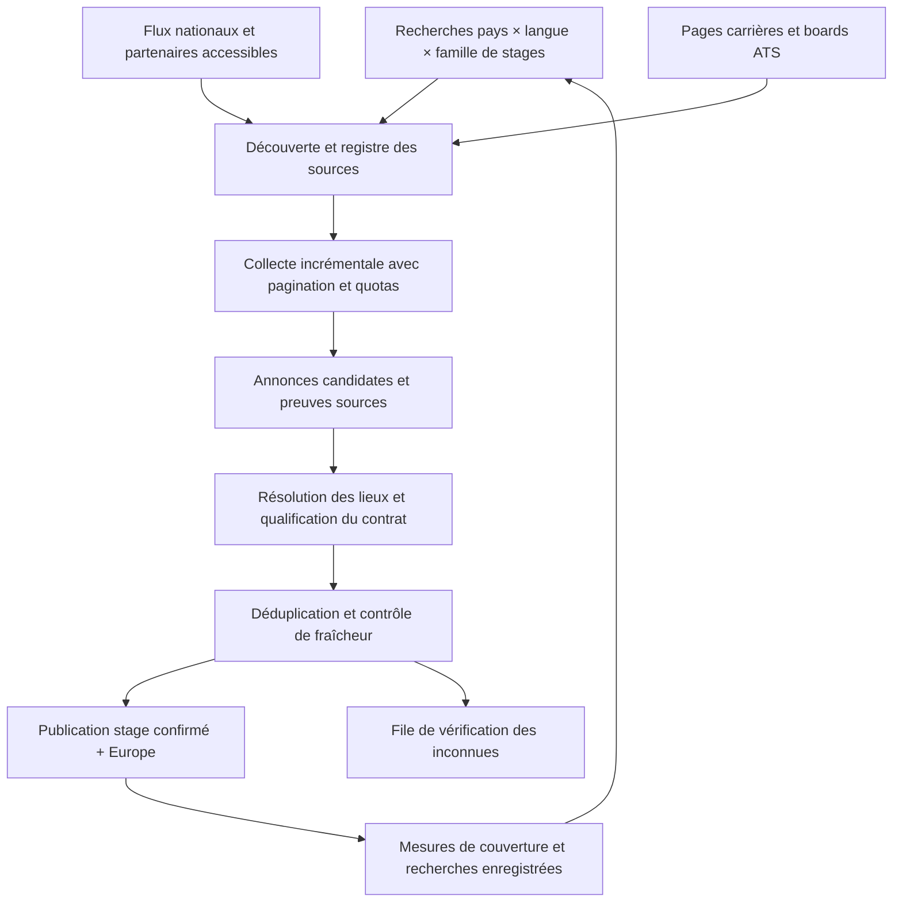

# InternHunt : collecte observée et écart de couverture

Vérifié le 30 septembre 2026. Le nom « InternHub » a été clarifié avec l'utilisateur : il s'agit de **internhunt.eu**. Inspection de pages publiques et de leur HTML/JavaScript, sans connexion, sans accès serveur ni contournement du verrou des liens de candidature. Les compteurs changent pendant la lecture.

## Conclusion

Notre catalogue de 159 annonces est un pilote de collecte trop petit pour l'objectif européen. InternHunt utilise une combinaison annoncée de grands sites d'emploi et de pages carrières, là où notre alimentation actuelle repose surtout sur quelques boards ATS sélectionnés manuellement. Le principal chantier est la découverte continue de sources et de postes, pas l'interface ni le matching. Rien ne permet d'affirmer qu'InternHunt couvre tous les stages européens.

## Ce qui est établi

| Observation | Preuve / portée |
|---|---|
| LinkedIn, Indeed, Glassdoor et plus de 100 pages carrières sont annoncés comme sources ; fusion et passage horaire sont annoncés | [Accueil](https://internhunt.eu/). Déclaration de l'éditeur ; cadence et provenance ligne par ligne non mesurées |
| Le catalogue non filtré est mondial | [Catalogue](https://internhunt.eu/jobs), régions Amériques/APAC/EMEA et annonces hors Europe visibles |
| 12 311 annonces dans le catalogue au moment de la lecture HTTP | Compteur HTML `Showing 50 of 12,311 roles` ; il ne mesure ni des stages européens seuls ni des postes uniques contrôlés |
| 6 612 annonces avec les cinq régions européennes choisies | [Requête Europe](https://internhunt.eu/jobs?region=Western+Europe&region=UK+%26+Ireland&region=Southern+Europe&region=Nordics&region=Eastern+Europe). Le Moyen-Orient est explicitement exclu de cette requête ; ce sont les catégories du site, pas un audit géographique indépendant |
| La première page européenne contient 50 lignes et 39 libellés d'entreprise distincts | Extraction du HTML public ; TD et TD Securities restent deux libellés, pas forcément deux entreprises distinctes |
| 12 des 50 titres de cette page indiquent un apprentissage, emploi étudiant ou programme diplômé | Revue des intitulés : six Werkstudent, un Working Student, deux emplois étudiants allemands, deux Graduate Programme et un Apprentice. Échantillon récent non aléatoire ; ne pas extrapoler 24 % au catalogue entier |
| Au moins une fiche exclue de notre définition est explicitement un apprentissage | [Fiche 58356](https://internhunt.eu/jobs/58356), description et qualification apprenticeship. Les autres exclusions de l'échantillon reposent sur leur titre |
| Certains postes sont regroupés entre lieux | [Fiche NVIDIA](https://internhunt.eu/jobs/58305) : un rôle et deux autres villes liées. Cela montre un regroupement visible, pas son algorithme de déduplication |
| Les résultats sont rendus dans le HTML et les filtres rechargent du HTML | HTML du catalogue : `loadJobs()` appelle `fetchWithTimeout()` en GET avec `Accept: text/html`, puis remplace le conteneur de résultats |
| Les descriptions proviennent au moins d'un flux traité comme du contenu collecté | HTML de la fiche : fonction `cleanMarkdown()` et commentaire relatif au Markdown scrapé, rendu par marked 9.1.6 |
| Les liens directs de candidature nécessitent un compte dans les pages visitées | [Fiche NVIDIA](https://internhunt.eu/jobs/58305) ; ils ne sont pas disponibles dans notre lecture anonyme. Aucun contournement tenté |

Les métadonnées de mesure, IDs des exemples exclus et empreintes des pages examinées figurent dans [l'audit JSON](2026-09-30-internhunt-audit.json). Les descriptions complètes ne sont pas recopiées dans le dépôt.

## Ce qui reste inconnu

Bibliothèque de collecte, langage/framework serveur, base, fournisseur IA, requêtes exécutées sur chaque plateforme, registre complet des entreprises, taux de couverture, budget réseau, règles de fermeture et performances réelles de déduplication. Le JavaScript de présentation ne révèle pas le backend. Le dépôt GitHub homonyme trouvé par recherche pointe vers un autre site ; aucun lien d'identité n'est établi, donc il n'est pas utilisé comme code d'InternHunt.

JobSpy ou des scripts dédiés pourraient fournir une partie du pipeline, mais il n'existe ici aucune preuve qu'InternHunt les utilise. Ne pas transformer une bibliothèque plausible en conclusion de reverse engineering.

## Pourquoi notre catalogue est beaucoup plus petit

1. **Découverte insuffisante.** Notre registre pilote ne surveille que 17 boards, dont 16 importés avec succès lors du dernier contrôle. La boucle HTML existante part de domaines déjà autorisés ; elle ne découvre pas largement les employeurs depuis des recherches nationales.
2. **Familles de sites manquantes.** Greenhouse, Ashby, Lever et SmartRecruiters ne couvrent pas tous les employeurs. Workday, Personio, Recruitee, SuccessFactors, Taleo, iCIMS et les sites propres doivent être évalués source par source. Leur présence dans une liste de technologies ne signifie pas qu'un accès global anonyme existe.
3. **Pas d'alimentation transversale par sites d'emploi.** Nous n'avons pas l'équivalent vérifié de la collecte LinkedIn/Indeed/Glassdoor annoncée par InternHunt, ni un réseau de flux nationaux et universitaires couvrant tous les domaines.
4. **Rappel réduit par les lieux inconnus.** Un pays absent laisse aujourd'hui de vraies offres en attente. Il faut résoudre les villes de façon contextualisée et sourcée, sans transformer automatiquement London en Royaume-Uni ni un bureau de siège en lieu du poste.
5. **Périmètre plus strict.** Nous excluons les emplois étudiants, apprentissages et programmes diplômés. Cette différence explique une partie de l'écart, jamais la totalité. Elle ne justifie pas de rester à quelques dizaines d'entreprises.
6. **Orientation métier différente.** InternHunt se présente comme un outil pour stages tech et entreprises prestigieuses. Notre objectif tous domaines exige aussi santé, droit, industrie, commerce, hôtellerie, institutions et recherche ; recopier sa sélection ne suffirait pas.

## Architecture à retenir pour la suite

Deux opérations différentes doivent être planifiées : découvrir des entreprises/offres nouvelles, et actualiser celles déjà connues. Un cron qui réimporte les mêmes 17 boards ne résout pas la couverture.

La [stratégie de sources vérifiées](2026-09-30-europe-coverage-strategy.md) distingue les API sans clé, les flux par employeur, les accès partenaires et les interfaces publiques non documentées. L'élargissement ne doit pas dépendre d'une clé ou d'un accord que nous ne possédons pas.

## Critère de réussite

Viser tous les stages publics détectables en Europe, tous domaines, sans annoncer une exhaustivité impossible à vérifier. Mesurer le rappel sur un échantillon indépendant d'annonces employeurs actives, réparti par pays/langue/domaine ; mesurer séparément contrats incorrects, pays incorrects, annonces périmées et doublons. Augmenter seulement le compteur en important des emplois hors périmètre n'est pas un progrès.

Ce document est une recherche et une correction de trajectoire. Il n'annonce pas que les nouvelles sources ou les nouveaux connecteurs sont déjà en production.
