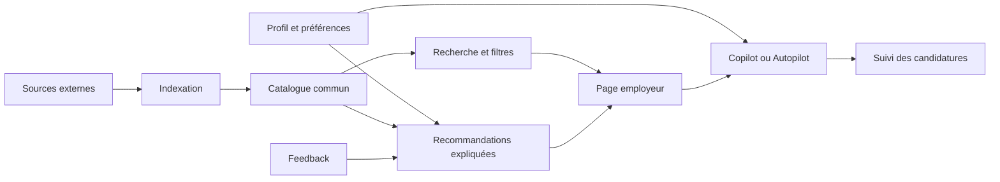

# Simplify — analyse publique pour le moteur européen de stages

Consultation : 30 septembre 2026. Périmètre : pages publiques et aide officielles ; aucun compte créé, aucune candidature, aucune inspection de code serveur. Les fonctionnalités décrites dans l'aide sont **documentées par l'éditeur**, pas toutes testées en session authentifiée.

## Conclusion

Simplify articule un catalogue commun, un profil candidat partagé, des recommandations expliquées, une assistance à la candidature et un suivi. Pour Intern, les apports prioritaires sont le catalogue indépendant du matching, les raisons de recommandation, les exclusions, la vérification de fraîcheur et les actions persistantes sur les offres. La couverture européenne exhaustive n'est pas démontrée et ne doit pas être déduite de la portée internationale de son extension.

## Preuves et limites

| Sujet | Preuve primaire consultée | Statut / conséquence |
|---|---|---|
| Ingestion | L'accueil indique indexer quotidiennement plus de 50 job boards et pages carrières ; annonce aussi des ajouts horaires. [Accueil](https://simplify.jobs/) | Déclaration marketing. Ces deux cadences peuvent correspondre à des opérations différentes ; aucune mesure ni preuve d'un passage horaire sur chaque source. |
| Recherche publique | `/jobs` expose une recherche et des filtres localisation, contrat, expérience, catégorie. Le rendu textuel consulté contient « Searching… » et des placeholders. [Catalogue](https://simplify.jobs/jobs) | Observation directe limitée. Elle ne permet pas de compter les offres ni de prouver la méthode de rendu ou la stack. |
| Recherche vs matching | Job Board et Job Matches naviguent la même base ; le second sélectionne un lot quotidien personnalisé. [Comparaison officielle](https://help.simplify.jobs/en/help/articles/6542018-job-matches-vs-job-board) | Fonctionnement documenté. Le catalogue reste explorable hors préférences. |
| Matching | Profil, expérience, CV, préférences et retours utilisateur contribuent au classement ; un panneau explique les correspondances. Actions Apply, Save, Hide, Hide company et Already Applied. [Job Matches](https://help.simplify.jobs/articles/2166608-using-your-job-matches) | Documenté. Algorithme, poids, calibration et modèles inconnus. |
| Préférences | Plusieurs métiers, lieux, secteurs, tailles d'entreprise, rémunération et intérêts ; exclusions ; notifications quotidiennes, hebdomadaires ou désactivées. [Préférences](https://help.simplify.jobs/articles/7272801-setting-your-job-match-preferences) | Documenté. Distinction utile entre qualification et envie réelle de postuler. |
| Fiche offre | Indication de vérification récente, résumé et description complète, exigences structurées, contexte entreprise, correspondance CV ; Apply ouvre la candidature employeur. [Fiche documentée](https://help.simplify.jobs/en/help/articles/2830264-viewing-jobs-on-simplifys-job-board) | Documenté. Procédure réelle de vérification et seuil de fraîcheur non publiés dans cette source. |
| Géographie | Liste officielle : US, Canada, Royaume-Uni, Australie, France, Allemagne, Inde, Irlande, Italie et Espagne. [Régions](https://help.simplify.jobs/articles/6895855-supported-countries-and-regions) | Déclaration de couverture catalogue/matching. Six pays européens listés ; aucune preuve de couverture complète de l'Europe. |
| Profil | Import du CV pour extraire formation, expériences et compétences, ou saisie manuelle ; profil utilisé dans les différents outils. [Inscription](https://help.simplify.jobs/articles/0738509-signing-up-for-simplify) | Documenté. Ne démontre pas la qualité du parsing multilingue. |
| Copilot | Extension préremplissant depuis le profil, avec relecture et soumission par l'utilisateur ; plateformes citées : Workday, Lever, Greenhouse, Ashby, iCIMS, Taleo. [Installation](https://help.simplify.jobs/en/help/articles/1749022-installing-and-setting-up-copilot) | Documenté. Compatibilité formulaire ≠ source d'ingestion du catalogue. |
| Tracker | Sauvegardes et candidatures, ajout externe manuel ou par extension, import CSV. [Tracker](https://help.simplify.jobs/en/articles/2140179-using-the-job-tracker) | Documenté. La page emploie à la fois ajout automatique et invitation à ajouter après soumission : ne pas inférer une détection universelle garantie. |
| Autopilot | Bêta pour une partie des membres Simplify+ ; l'utilisateur choisit un poste, le système remplit et soumet. L'automatisation des matchs quotidiens est annoncée comme future. [Autopilot](https://help.simplify.jobs/en/help/articles/1784339-getting-started-with-autopilot) | Documenté, accès restreint. À distinguer strictement du Copilot. |

## Reconstruction plausible, non vérification serveur

Cette architecture est une inférence à partir des fonctions documentées. Elle ne prouve ni schéma de base, ni file de tâches, ni LLM, ni framework, ni connecteurs exacts. Une requête HTTP Python vers le catalogue a retourné HTTP 403 ; aucun contournement n'a été tenté. Les pages d'aide et le rendu public obtenu par recherche constituent l'essentiel des preuves disponibles.

Inconnus : discovery des entreprises, pagination et retries, déduplication intersources, identification des stages, langues couvertes, taux de faux positifs, suppression des offres expirées, fraîcheur mesurée, coût et stack.

## À reprendre dans Intern

Propositions de conception, et non affirmations sur l'implémentation de Simplify :

1. **P0 — Catalogue et matching séparés.** Une offre importée une fois ; recherche complète disponible sans profil ; classement candidat calculé ensuite.
2. **P0 — Raisons explicites.** Afficher critères satisfaits, contradictions et données manquantes ; distinguer préférences et contraintes bloquantes. Conserver l'extrait source pour chaque condition de stage.
3. **P0 — Fraîcheur vérifiable.** `last_seen_at`, `last_verified_at`, état et provenance. Un échec réseau n'est pas une fermeture.
4. **P0 — Actions persistantes.** Sauvegarder, masquer offre/entreprise, déclarer déjà postulé ; ces actions survivent à une réimportation et à une fusion de doublons.
5. **P1 — Préférences négatives et feedback motivé.** « Mauvais métier », « pays incompatible », « durée incompatible », « pas un stage » ; ne pas apprendre une exclusion durable d'un simple clic.
6. **P1 — Alertes contrôlables.** Fréquence, canaux et recherches sauvegardées ; ne pas renvoyer la même offre parce qu'une autre source la republie.
7. **P1 — Import d'une URL externe.** Ajouter une opportunité au suivi même hors catalogue, avec provenance et vérification avant éventuelle publication commune.
8. **P2 — Profil/CV et préremplissage.** Extension séparée du moteur de collecte ; couverture explicitement mesurée par portail.

Ne pas prioriser les streaks recruteurs, prédictions de compétitivité ou candidatures automatiques pour valider le moteur. Leur valeur dépend d'un volume et d'une qualité de données encore à établir. Ne pas transformer un historique de sponsoring entreprise en garantie d'éligibilité d'un stage donné.

## Différenciation européenne à spécifier

La documentation de Simplify justifie un objectif distinct : matrice pays × domaines × langues, dates et durées de stage, convention, niveau/année de formation, lieu réel et pays autorisés pour le télétravail. La disponibilité d'un outil de candidature dans un pays ne compte pas comme preuve de couverture de son catalogue. Toute promesse de couverture doit être accompagnée du nombre de sources saines et d'offres vérifiées, sans prétendre connaître le dénominateur de tous les stages européens.
