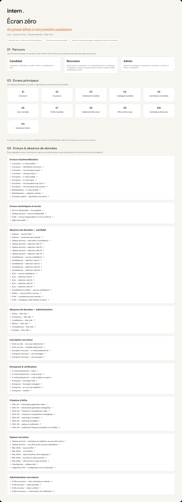

# Étape 2 : Prototype Figma

Le prototype présente les parcours candidat, recruteur et administrateur.
L'écran zéro donne accès aux écrans principaux, aux variantes et aux états
d'erreur ou d'absence de données.

[Ouvrir le fichier Figma](https://www.figma.com/design/2zB64zoXsnJQ24R1yysJ72/Intern?node-id=223-301&t=Pgc5H2wNNSiyyS3W-1)
 · [Tester le prototype](https://www.figma.com/proto/2zB64zoXsnJQ24R1yysJ72/Intern?node-id=223-302&p=f&viewport=191%2C-32%2C0.02&t=u6i49kJLKHdhAkM4-8&scaling=scale-down-width&content-scaling=fixed&page-id=223%3A301&starting-point-node-id=223%3A302&hide-ui=1)

## Livrables

- [Figma.md : étapes d’ingénierie, corrections, prompts conservés et reprise](../docs/Figma.md) ;
- `figma_link.txt` : liens vers le fichier et les trois parcours ;
- `ecran_zero.jpg` : capture de l'écran zéro ;
- `figma_manifest.json` : identifiants des points de départ et contrôle du prototype.

## Parcours

- candidat : inscription, compte en attente, connexion, profil, offres et candidatures ;
- recruteur : inscription, vérification professionnelle, entreprise, offres et candidatures ;
- administrateur : connexion, accueil, utilisateurs et offres.

Le rôle est déterminé par le compte utilisé. Le sélecteur de rôle sert
uniquement pendant l'inscription.

## Comparaison avec l’application

La comparaison avec le prototype Figma a été réalisée (T25). L’équipe en a
confirmé l’achèvement le 21 octobre 2026 ; voir le
[suivi de la comparaison](../tests/figma-comparison.md) et le
[cahier de recette](../tests/cahier_de_tests.pdf).
