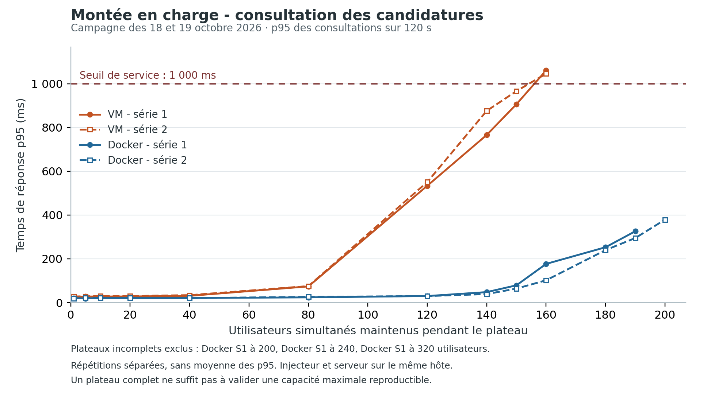

# Mesures complémentaires de capacité et de workers

Mise à jour du 21 octobre 2026. Cette synthèse complète les essais historiques
de 1 à 20 utilisateurs ; elle ne modifie aucun résultat ni rapport archivé.
La courbe et sa procédure de reproduction ont été ajoutées le 25 octobre 2026.

## Courbe de montée en charge



L’axe X indique les utilisateurs simultanés maintenus ; l’axe Y, le p95 des
consultations pendant les 120 secondes de plateau. Chaque point provient d’un
fichier `serie-{1,2}/{vm,docker}/{utilisateurs}/synthese.json` de la campagne
`capacite-20261018-195024-455892`. Les 45 plateaux complets sont tracés ; les
trois plateaux incomplets Docker série 1 à 200, 240 et 320 sont exclus.
Le point à 200 sous Docker correspond seulement à la série 2. Les paliers sont
ceux mesurés, les segments guident la lecture et les p95 ne sont pas moyennés.

Le seuil de 1 000 ms vient du protocole. Les critères d’erreur et de répétabilité
restent nécessaires : cette courbe seule ne valide pas une capacité maximale.
Les campagnes historiques à 1–20 utilisateurs et les essais de workers ne sont
pas mélangés à cette série.

Depuis la racine du dépôt, avec `uv` :

```sh
uv run --no-project --with matplotlib==3.10.7 python mesure/scripts/generate_capacity_chart.py
```

Le [script](../scripts/generate_capacity_chart.py) lit les synthèses archivées
sans les modifier et génère le [PNG](courbes/capacity-p95.png), le
[PDF vectoriel](courbes/capacity-p95.pdf) intégré au rapport et le
[CSV de contrôle](courbes/capacity-p95.csv). Le CSV inclut les 48 essais, leur
statut de plateau, les utilisateurs effectifs, les erreurs sur l’essai entier,
le chemin source et son empreinte SHA-256. Il permet de retrouver aussi les
essais exclus de la courbe.

## Campagne de capacité des 18 et 19 octobre

La campagne `capacite-20261018-195024-455892` conserve **48 essais vérifiés**.
Le protocole utilise 30 s de montée, 15 s de stabilisation, 120 s de plateau
et 1 s de réflexion. Les seuils sont p95 ≤ 1 000 ms, erreurs stables ≤ 1 %
et divergence entre répétitions ≤ 10 %. Un plateau n’est valide que si la
charge effectivement maintenue correspond à la charge demandée.

Le tableau donne les séries **1 / 2**, sans moyenner les p95. Le débit compte
les consultations réussies pendant la fenêtre stable. Les essais du tableau
n’ont aucune erreur sur l’essai entier ; un p95 trop élevé peut néanmoins
dépasser le seuil de service.

| Utilisateurs | Débit VM (req/s) | p95 VM (ms) | Débit Docker (req/s) | p95 Docker (ms) |
| ---: | ---: | ---: | ---: | ---: |
| 80 | 77,35 / 77,27 | 74,00 / 75,45 | 78,64 / 78,54 | 24,00 / 26,00 |
| 120 | 86,37 / 86,32 | 533,85 / 551,00 | 117,86 / 117,90 | 30,00 / 30,00 |
| 140 | 85,10 / 85,08 | 766,00 / 876,00 | 137,04 / 137,39 | 48,00 / 39,00 |
| 150 | 86,11 / 83,63 | 906,40 / 966,25 | 146,13 / 146,55 | 79,00 / 64,00 |
| 160 | 84,13 / 84,56 | 1061,00 / 1046,00 | 153,19 / 154,79 | 176,90 / 102,00 |
| 180 | — | — | 162,06 / 164,85 | 253,00 / 240,00 |
| 190 | — | — | 164,12 / 163,21 | 326,00 / 295,00 |

En VM, le débit plafonne autour de **84 à 86 req/s** dès 120 utilisateurs,
alors que le p95 dépasse **1 s à 160** dans les deux séries. Des signaux de
plafonnement apparaissent entre 120 et 140, puis 140 et 150 utilisateurs.
Docker atteint environ **163 à 164 req/s à 190 utilisateurs**, avec un signal
de plafonnement entre 180 et 190. Les charges supérieures à la borne refusée
en VM ne sont pas rejouées.

### Charges demandées et plateaux incomplets

| Déploiement | Série | Charge demandée | Utilisateurs effectivement maintenus | Erreurs sur l’essai entier | Lecture |
| --- | ---: | ---: | ---: | ---: | --- |
| Docker | 1 | 200 | 8 | 192 | Plateau invalide |
| Docker | 2 | 200 | 200 | 0 | Plateau valide ; 164,78 req/s, p95 379,00 ms |
| Docker | 1 | 240 | 190 | 50 | Plateau invalide |
| Docker | 1 | 320 | 20 | 300 | Plateau invalide |

La première série Docker à 200 compte 192 erreurs sur l’essai entier :
45 à la connexion et 147 à la consultation. Ses 8 utilisateurs maintenus,
ainsi que les plateaux incomplets à 240 et 320, ne prouvent pas la tenue
aux charges demandées. Le taux
d’erreur des seules consultations stables ne remplace pas le contrôle des
connexions et de la charge réellement atteinte.

**Aucune capacité maximale n’est validée.** Le p95 diverge de **13,40 %**
à 140 utilisateurs en VM et jusqu’à **53,71 %** à 160 sous Docker. Les
divergences supérieures à 10 %, les essais incomplets et l’interruption
documentée empêchent de retenir une capacité reproductible.

Sources : [protocole](../preuves/capacite-20261018-195024-455892/protocole.json),
[analyse chiffrée](../preuves/capacite-20261018-195024-455892/analyse/capacite.json),
[rapport archivé](../preuves/capacite-20261018-195024-455892/analyse/rapport.md),
[manifeste des 48 essais](../preuves/capacite-20261018-195024-455892/manifest.json)
et [incidents](../INCIDENTS.md). Les synthèses par palier sont dans les dossiers
`serie-1/` et `serie-2/` de cette campagne.

## Comparaison de 2 et 4 workers Gunicorn

Les deux campagnes du 19 octobre inversent l’ordre des réglages : 2 puis 4,
puis 4 puis 2. Elles restaurent la même base et conservent les mêmes ressources
pour chaque déploiement. Les charges sont 80, 100 et 130 en VM ; 150, 180 et
200 sous Docker. Les 24 essais ont un plateau valide et aucune erreur.

Au dernier palier de chaque campagne, valeurs des séries **1 / 2** :

| Déploiement et utilisateurs | Débit, 2 workers (req/s) | Débit, 4 workers (req/s) | p95, 2 workers (ms) | p95, 4 workers (ms) |
| --- | ---: | ---: | ---: | ---: |
| VM, 130 | 86,28 / 84,24 | 96,63 / 99,78 | 708,00 / 721,00 | 521,00 / 443,00 |
| Docker, 200 | 163,47 / 162,14 | 195,19 / 195,19 | 373,00 / 385,00 | 60,00 / 55,00 |

Sous Docker à 200 utilisateurs, 4 workers augmentent le débit de **19,4 %**
puis **20,4 %** et abaissent le p95. Ce résultat soutient l’hypothèse d’une
limite liée aux workers ; il ne prouve ni un gain de capacité maximale ni
l’effet d’un répartiteur de charge. La comparaison VM garde un gain observé,
mais ne satisfait pas le critère strict de répétabilité des p95.

Sources : [rapport workers Docker](../preuves/worker-20261019-103419-13231/rapport-workers.md)
et [rapport workers VM](../preuves/worker-vm-20261019-143401-202396/rapport-workers.md).

## Limites du protocole et prochaines mesures

JMeter et le déploiement testé utilisent le même poste physique. Ils partagent
donc CPU, mémoire et E/S : à forte charge, une dégradation peut venir du
serveur, de l’injecteur ou de leur concurrence. L’étalonnage statique et les
métriques limitent cette incertitude sans supprimer ce biais.

Les prochains essais doivent utiliser **deux machines physiques distinctes** :
une machine cliente dédiée génère les requêtes JMeter ; l’autre héberge le
serveur testé, VM ou conteneurs. Il faut contrôler la capacité de l’injecteur
et du réseau, stabiliser l’hôte serveur, aligner les quotas et répéter les
séries sans interruption. Les résultats restent propres au scénario fictif
de consultation et ne couvrent pas tous les usages de production.

## Perspectives de déploiement

Étudier un **répartiteur de charge (load balancer)** devant plusieurs instances
Django/Gunicorn, avec sondes de santé, sessions partagées via PostgreSQL et
stockage commun des documents. Vérifier aussi les limites de connexions à la
base et les ressources de chaque instance.

Comparer ensuite une instance et plusieurs instances avec répartition :
débit, p95, erreurs, charge des composants et comportement lors de la perte
d’une instance. Cette architecture reste une évolution future ; elle n’a pas
été déployée ou mesurée par les campagnes ci-dessus.
